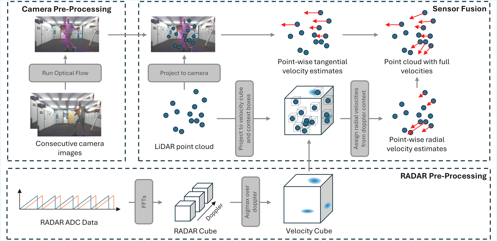
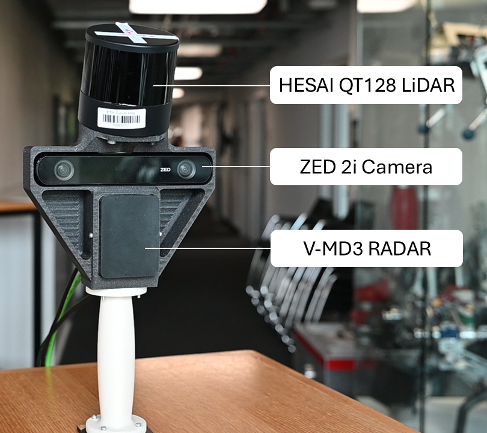

# CaRLi-V: Camera-RADAR-LiDAR point-wise Velocity estimation

<h3 align="center">
<a href="https://arxiv.org/abs/2511.01383v2">arXiv</a> | <a href="https://drive.google.com/drive/folders/1aJDNRScPyRDfbrbxfj-WOtP90-EwgWLH?usp=drive_link">Dataset</a>
</h3>

If you find our work useful for your research, please cite our paper:
```
@ARTICLE{11558415,
  author={Guo, Landson and Aguilar, Andres M. Diaz and Talbot, William and Tuna, Turcan and Hutter, Marco and Cadena, Cesar},
  journal={IEEE Robotics and Automation Practice}, 
  title={CaRLi-V: Camera–RADAR–LiDAR Point-Wise 3-D Velocity Estimation}, 
  year={2026},
  volume={1},
  number={},
  pages={138-143},
  keywords={Radar;Laser radar;Estimation;Cameras;Fluid flow;Distance measurement;Grounding;Optical flow;Pipelines;Videos;Computer vision for automation;datasets for robotic vision;range sensing;sensor fusion;visual tracking},
  doi={10.1109/RAP.2026.3702579}}
```

## Overview

This repository comprises of a ROS2 package for 3D dense point-wise velocity estimation using a camera, RADAR, and LiDAR fusion framework.

Accurate point-wise velocity estimation in 3D is vital for enabling robot interaction with non-rigid dynamic agents such as humans, enabling robust performance in path planning, collision avoidance, and object manipulation in dynamic settings. To this end, we propose a novel RADAR, LiDAR, and camera fusion pipeline for point-wise 3D velocity estimation named CaRLi-V. This pipeline leverages a novel RADAR representation, the velocity cube, which densely represents radial velocities within the RADAR's field-of-view. By combining the velocity cube for radial velocity extraction, optical flow for tangential velocity estimation, and LiDAR for dense point-wise localization measurements through a closed-form formulation, our approach can produce detailed velocity measurements for a dense array of points.


The pipeline is divided into three steps: RADAR pre-processing, where raw ADC RADAR data is used to compute the RADAR velocity cube, a dense representation of velocities in the environment; Camera pre-processing, where two consecutive camera images are used to compute optical flow vectors for each pixel in the image; Sensor fusion, where the LiDAR point cloud is projected into both representations to extract radial velocity and optical flow readings, with both estimates combined through a closed-form solution.


The pipeline is able to (a) discern velocities between different dynamic agents; (b) estimate both radial and tangential velocities, as well as combinations of both, and (c, d) extract velocities from single parts of non-rigid moving agents, such as individual limbs in humans.

See a demonstration of our pipeline in action by clicking on the image below:

[](https://youtu.be/oy1B_Mmpvt0)

## Installation

This repository was built on Ubuntu 22.04 for ROS2 Humble. To install the necessary packages to run the ROS nodes:

```
cd ros
pip install -r src/carli_v/requirements.txt
```

Then build using colcon:

```
colcon build --symlink-install
source install/setup.bash
```

## Usage
Several launch files exist to facilitate the running of the pipeline.

To run the full pipeline:
```
ros2 launch carli_v radar_full_velocity.launch.py
```

To run only the radar-lidar fusion node (for radial velocities only):
```
ros2 launch carli_v radar_mode.launch.py
```

We developed the ROS node using usage with our own sensor rig consisting of a Zed 2i Camera, HESAI QT128 LiDAR, and V-MD3 RADAR.

If running on live data, the nodes expect LiDAR messages to be broadcast on the topic `/hesai_lidar` as a PointCloud2 topic, RADAR ADC data to be broadcast as an Image on `/radar_ADC`, and image data in `/camera/image_raw`. Modifications will have to be made for running with other sensors. Otherwise, see [Testing](#testing) for testing with an annotated dataset.

## Evaluation
Our test results were compiled against existing scene flow algorithms as implemented in [OpenSceneFlow](https://github.com/KTH-RPL/OpenSceneFlow). 

To reproduce the test results, download our [annotated ground-truth dataset](https://drive.google.com/drive/folders/1aJDNRScPyRDfbrbxfj-WOtP90-EwgWLH?usp=drive_link) into the folder `/datasets` under this repository.

<details>
<summary>
Note for evaluation on custom datasets:
</summary>
If using a custom dataset with our eval script, it should be in [Supervisely format](https://docs.supervisely.com/import-and-export/import/supported-annotation-formats/pointclouds/supervisely). Place the dataset under the folder `/datasets`,  The eval script will analyze objects with the name `Person` or `Reflector` in Scene 1
</details>

You can then export the raw pointclouds from our ROS node implementation as follows:
```
ros2 launch carli_v radar_full_velocity.launch.py save_pcd_as:=scene_1
```
This will save the output of the pipeline as a PCD file every time a new output is published.

The eval script must be run inside an OpenSceneFlow installation, so we use the ready-built Docker image to facilitate evaluation.

```
docker pull zhangkin/opensf@sha256:8c732a3b9332cd3df5d44f647e561f30dea1f0460878a484d03e5a694f94b2e4
docker tag zhangkin/opensf@sha256:8c732a3b9332cd3df5d44f647e561f30dea1f0460878a484d03e5a694f94b2e4 zhangkin/opensf:carli-v
docker run -it --net=host --gpus all -v /dev/shm:/dev/shm -v /home/kin/data:/home/kin/data --name opensf zhangkin/opensf:carli-v /bin/zsh
```

Copy the CaRLi-V repository and dataset directory into the container, and download OpenSceneFlow models from the Github page as desired. You can then run the evaluation as follows:

```
python eval/analysis.py # For evaluating our method
python eval/analysis.py --use-scene-flow-model checkpoint=/home/kin/teflow-av2.ckpt data_mode=val # eval TeFlow
python eval/analysis.py --use-scene-flow-model checkpoint=/home/kin/flow4d_best.ckpt data_mode=val # eval Flow4D
python eval/analysis.py --use-scene-flow-model checkpoint=/home/kin/deltaflow-av2.ckpt data_mode=val # eval DeltaFlow
```
